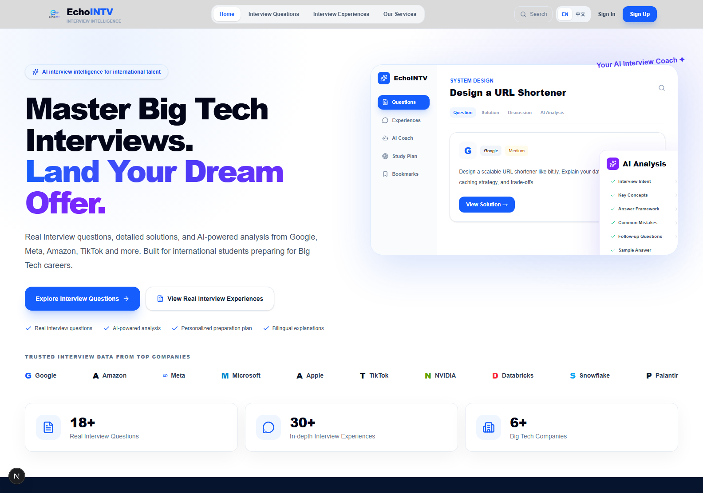

# EchoINTV — AI-Powered Interview Preparation

<p align="center">
  <strong>Practice, learn, and get better at software engineering interviews.</strong>
</p>

<p align="center">
  <a href="https://www.echointv.shop">Live Website</a>
</p>



EchoINTV is a full-stack interview preparation platform built for software engineers pursuing Big Tech careers. It brings together real interview questions, an interactive coding workspace, detailed solutions, AI-powered analysis, interview experiences, and structured preparation tools in one bilingual learning environment.

## What the Website Offers

### Interview Question Library

- Browse questions by company, difficulty, category, and topic.
- Study algorithm, object-oriented design, and system design questions.
- Review structured descriptions, examples, constraints, approaches, solutions, complexity analysis, and interview insights.
- Open individual questions in a focused practice workspace.

### Interactive Coding Practice

- Write code in a Monaco-powered editor.
- Switch between Python, Java, and C++.
- Run Python solutions directly in the browser.
- Resize the question, editor, and practice-console panels.
- Switch between light and dark workspace themes.
- Use examples, custom tests, output history, hints, and personal practice notes.
- Review reference solutions only when needed.

### Guided Interview Preparation

- Learn how to think about a problem before reading code.
- Review key observations and step-by-step approaches.
- Understand time and space complexity with explanations.
- Study common mistakes, key concepts, follow-up questions, and better answer strategies.

### Interview Experiences and Resources

- Read long-form interview experience articles.
- Explore preparation resources and company-focused content.
- Use Markdown, syntax highlighting, mathematical notation, and structured technical content.

### Accounts and Membership

- Register and sign in with email or Google.
- Access profile and membership features.
- Support free and premium content access.
- Integrate checkout and webhook-based payment workflows.

### Administration and Content Management

- Create and edit interview questions through structured forms.
- Import labelled text, Markdown, or JSON into the question editor.
- Manage multiple examples, parameters, solutions, constraints, approaches, and AI analysis fields.
- Review imported drafts before publishing.
- Search, edit, view, delete, and bulk-delete questions.
- Manage articles and user access.

## Technology Stack

- Next.js 16 with the App Router
- React 19 and TypeScript
- Tailwind CSS 4
- Prisma ORM with PostgreSQL
- Monaco Editor
- React Markdown, Remark, Rehype, Highlight.js, and KaTeX
- Google OAuth and session-based authentication
- PayPal and Paddle payment integrations
- Notion-powered interview content import

## Main Routes

- `/` — product overview and featured content
- `/problem` — interview question library
- `/problem/[slug]` — interactive question and coding workspace
- `/blog` — interview experiences and articles
- `/pricing` — membership plans
- `/profile` — user profile and account information
- `/admin` — administration dashboard
- `/admin/problems` — question management
- `/admin/problems/new` — structured question creation and content import
- `/admin/ai-import` — imported draft review workflow

## Local Development

### Requirements

- Node.js 20 or newer
- npm
- PostgreSQL for database-backed features

### Installation

```bash
git clone <your-repository-url>
cd echo
npm install
```

Create a `.env` file and configure the services required by your environment. Common variables include:

```env
DATABASE_URL=
SESSION_SECRET=
NEXT_PUBLIC_SITE_URL=http://localhost:3000

GOOGLE_CLIENT_ID=
GOOGLE_CLIENT_SECRET=

SMTP_HOST=
SMTP_PORT=
SMTP_USER=
SMTP_PASS=

NOTION_TOKEN=
NOTION_INTERVIEW_DATABASE_ID=

PAYPAL_CLIENT_ID=
PAYPAL_CLIENT_SECRET=
PAYPAL_MODE=

PADDLE_WEBHOOK_SECRET_KEY=
```

Never commit real credentials or production secrets.

Generate the Prisma client and start the development server:

```bash
npx prisma generate
npm run dev
```

Open [http://localhost:3000](http://localhost:3000) in your browser.

## Available Commands

```bash
npm run dev
npm run build
npm run start
```

## Production Build

```bash
npm run build
npm run start
```

The build command generates the Prisma client before creating the optimized Next.js production build.

## Project Structure

```text
app/          Application routes, layouts, APIs, and global styles
components/   Reusable UI and practice-workspace components
data/         Local fallback content
lib/          Authentication, parsing, database, and service utilities
prisma/       Database schema and seed logic
public/       Static assets and browser-side runtime files
tests/        Parser and content workflow regression tests
```

## Content Workflow

1. Add a question manually or paste structured source content.
2. Review all parsed fields before saving.
3. Store examples, explanations, parameters, solutions, and analysis separately.
4. Preview the published question in the practice workspace.
5. Update or remove content from the administration dashboard.

## License

This repository is private. All rights are reserved by the EchoINTV project owner.
